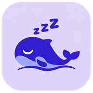
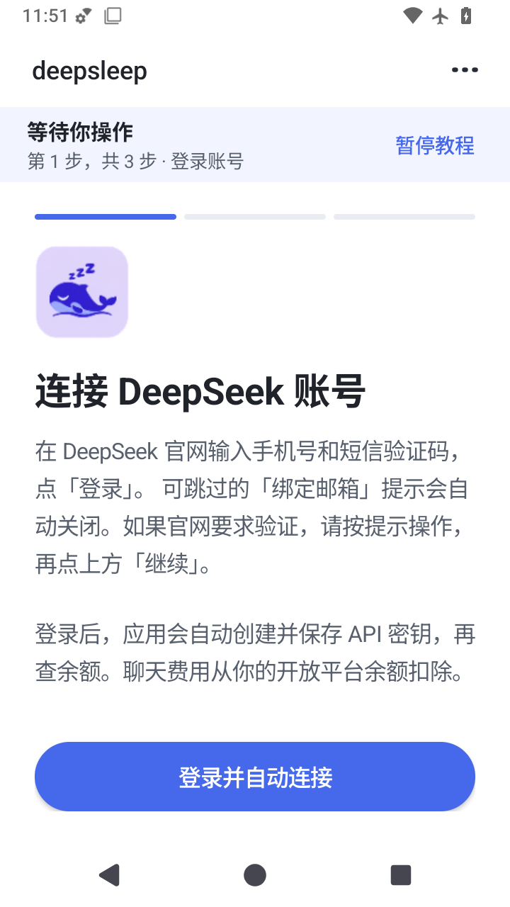
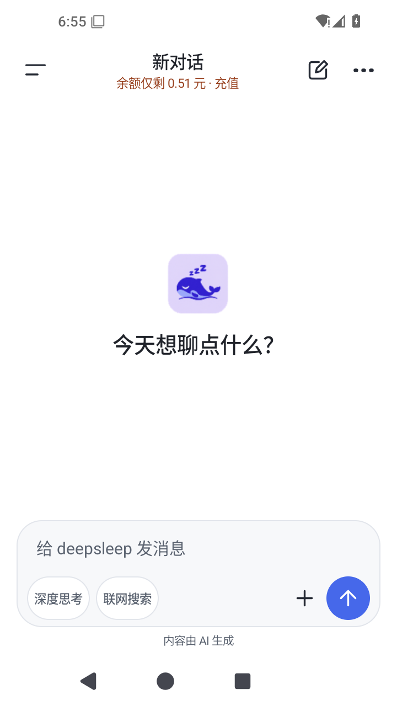
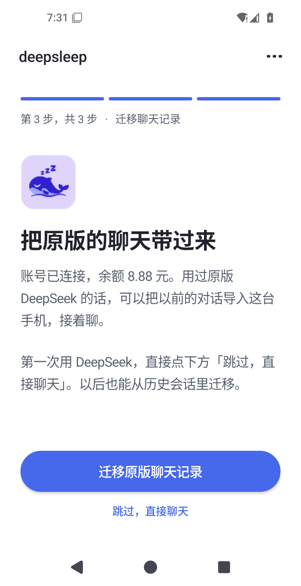
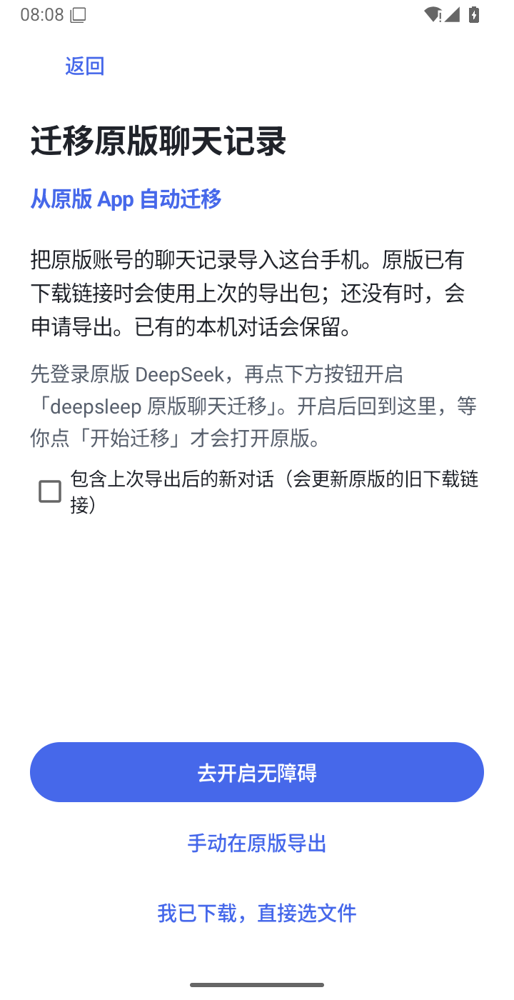
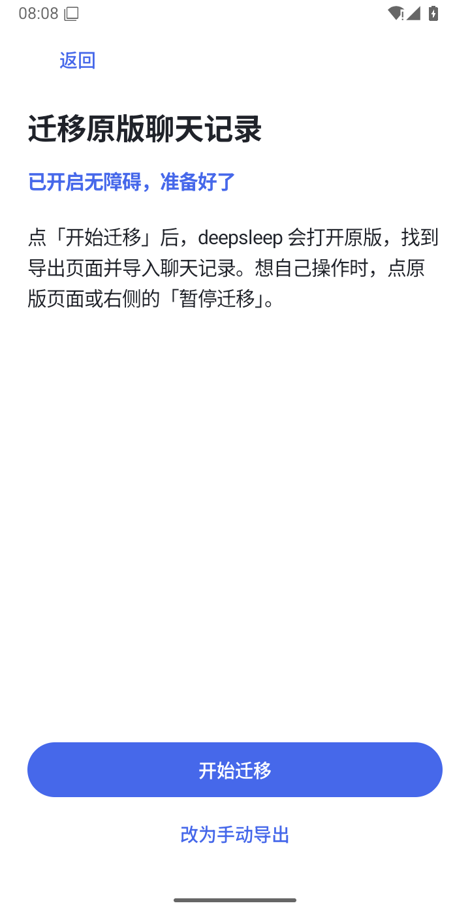

# deepsleep



deepsleep 是一款直连 DeepSeek 开放平台 API 的第三方 Android 聊天客户端，与 DeepSeek 无隶属关系。

## 下载安装

在 Android 8.0 或更新版本的手机上，下载并打开 APK 即可安装。之前装过同签名测试版的用户可以直接更新，保留本机聊天记录和已连接的账号。 [下载 deepsleep 1.0.0 APK](https://github.com/XYuki-cloud/deepsleep/releases/download/v1.0.0/deepsleep-1.0.0.apk) · [查看发布说明和校验文件](https://github.com/XYuki-cloud/deepsleep/releases/tag/v1.0.0)

在 Windows 上可用 `Get-FileHash .\deepsleep-1.0.0.apk -Algorithm SHA256` 计算下载文件的 SHA-256，与发布页公布的值比较。

## 第一次打开

1. 点 **登录并自动连接**。在打开的官网填手机号，点「发送验证码」。把短信里的数字填回网页，再点「登录」。如果网页显示密码框，先点「验证码登录」。应用会在官网创建一枚名为 `deepsleep` 的专用密钥，保存到这台手机并自动返回。
2. 等应用查余额。余额不足时，点 **去官网充值**，核对账号，选金额和支付宝。手机弹出「打开支付宝？」时，点 **打开支付宝**，在支付宝核对订单并确认付款。回到 deepsleep 会自动查余额。刚付过款还没有到账时，先点「重新查询余额」。已有可用余额可以直接进入最后一步。
3. 用过原版 DeepSeek，点 **迁移原版聊天记录**，按下面的说明把旧对话带过来。第一次用就点 **跳过，直接聊天**。以后打开应用会回到聊天，也可以从历史会话里重新进入迁移。

首次教程和自动连接页面顶部会显示当前状态。遇到可跳过的「绑定邮箱」弹窗，应用会点一次弹窗上的「×」，等它消失后接着连接。如果官网要求验证、找不到关闭按钮或弹窗再次出现，应用会停下。按官网提示处理后，点横幅上的「继续」即可。你也可以随时点「暂停」自己操作。如果已经提交过创建请求、网页又丢失了结果，应用会请你确认是否重新创建。

内置浏览器会识别登录、验证、密钥和充值页面。登录后落到用量或个人资料页时，会接回刚才的连接或充值流程。停在其他开放平台页面时，可以点「继续连接」或页面显示的充值入口。若官网页面有变动，自动连接未能完成，应用会提示你在当前网页复制刚创建的密钥，再点「已复制，返回连接」。本来就有密钥的用户可以从首次连接页右上角的「连接选项」导入。 [官方密钥页](https://platform.deepseek.com/api_keys)

 

右图中的 0.51 元为演示余额。

## 从原版 DeepSeek 迁移聊天记录

1. 从首次教程第 3 步或聊天页左上角的历史会话，点 **迁移原版聊天记录**。还没连接账号也可以从首次连接页右上角进入。原版 App 要登录存有旧对话的那个账号。
2. 点 **去开启无障碍**，在系统设置里点 **deepsleep 原版聊天迁移**，打开开关并确认。手机会回到 deepsleep；如果还停在系统设置，按返回键回到迁移页。
3. 无障碍已开启时，点 **开始迁移**。每次自动点击前，应用会在目标控件中央显示白点，悬浮提示会写明正在查找或准备点击的入口。现在才会打开原版，依次找侧边栏、设置、数据管理和导出页。需要自己操作时，先点浮窗上的 **暂停迁移**。轻触浮窗外的原版页面会继续当前迁移。暂停后点浮窗上的 **继续迁移**，就能从当前原版页面继续。暂停、退出或导入完成后，无障碍开关保持开启。需要再跑一次时，回到 deepsleep 点 **开始迁移**。
4. 原版已有导出包时，会导入上次导出的记录。想带上后来新增的对话，请在第 2 步前勾选「包含上次导出后的新对话」，原来的下载链接会更新。文件就绪后，服务点「复制下载链接」。deepsleep 回到前台下载并导入，显示新增和已有的会话数。点 **查看历史会话** 即可打开。从原版自动取得的 DeepSeek 专用云存储链接会直接下载。遇到新的文件托管域名，会先显示域名请你确认。 [DeepSeek 官方导出说明](https://cdn.deepseek.com/policies/zh-CN/deepseek-privacy-policy.html)

如果原版布局变了，找不到唯一可点的菜单时，自动迁移会暂停。可以在原版点左上角侧边栏 → 设置 → 数据管理 → 导出所有历史对话，再点「复制下载链接」。回到 deepsleep 的手动导出引导后，点 **导入刚复制的聊天记录**。想重新交给应用操作，也可以点 **返回自动迁移**。安卓不允许开启服务时，也可以直接选 **手动在原版导出**。手机已有导出文件时，选 **我已下载，直接选文件**；未安装原版时，可以在网页版按同一路径下载 ZIP。 [官方常见问题](https://static.deepseek.com/faq/index.html)

  

支持官网 v3 ZIP、包含 `conversations.json` 的旧版 ZIP，以及解压后的会话 JSON。保留会话标题、时间、当前分支的问答、思考文本和可识别的网页来源。历史附件保留文件名。需要其他回答分支或导出包自带的图片原件时，请保留原 ZIP。已有相同会话时保留本机版本，包括后来改过的标题和续聊。导入在本机进行。自动迁移只在原版刚复制链接、deepsleep 回到前台时读取剪贴板；手动迁移在你点「导入刚复制的聊天记录」时读取。临时导出包在读取后清理。 [官方导出格式](https://github.com/deepseek-ai/chat-demo/blob/main/src/services/chat/history/README.md)

ZIP 文件上限为 512 MiB，包内会话 JSON 累计解压大小上限也是 512 MiB；过大的 ZIP 可以解压后分次选择 `chat_sessions` 中的 JSON。单个会话超过 4 Mi 个 UTF-16 字符或含超过 10 万个 JSON 值时，会列入跳过数量。

## 余额和充值

聊天标题下方常驻显示开放平台余额。点金额就能去充值，想手动刷新时点右上角的 **···**。余额快用完时，金额会变色并显示「仅剩」。余额不足时，输入框中的问题会保留。聊天和文件解析的费用由 DeepSeek 从你的开放平台账号扣除。 [官方计费说明](https://api-docs.deepseek.com/zh-cn/quick_start/pricing/)

充值时，官网会先生成订单，再打开收银台。在「打开支付宝？」提示里点 **留在网页** 可以继续看订单，准备付款时再点网页上方的 **打开支付宝**。若手机没能唤起支付宝，点右上角的 **用浏览器打开**。应用会优先把本次收到的支付宝收银台链接交给手机浏览器。如果尚未收到链接，会打开 DeepSeek 官方充值页，浏览器可能需要重新登录。已经付款时，直接返回 deepsleep 查余额。

应用使用官网返回的可用总额，包含有效赠金。人民币余额大于 0 且不超过 1 元、美元余额大于 0 且不超过 0.15 美元时提醒；有多币种余额时，只要其中一项充足就不提醒。查询失败会提示重试。 [官方余额接口](https://api-docs.deepseek.com/zh-cn/api/get-user-balance/)

## 聊天功能

- 使用 `deepseek-flash` 流式回复，可停止生成或重新生成最近一条回复，支持 Markdown、复制、分享和朗读。语音输入和朗读依赖设备上的系统服务。
- 深度思考和联网搜索可分别开关。开启搜索后，模型可以按需搜索网页或读取链接。回复中可以展开思考过程和打开来源链接。 [联网工具](https://api-docs.deepseek.com/zh-cn/guides/web_tools/)
- 发送时可上传最多四个附件，支持常见图片、PDF、Word、PowerPoint、表格和纯文本。文件的大小和解析限制取决于类型。 [文件上传](https://api-docs.deepseek.com/zh-cn/guides/files_api/) · [文件解析](https://api-docs.deepseek.com/zh-cn/guides/document_parsing/)
- 可新建、切换、重命名和删除会话，按标题或最近一条消息搜索。会话和草稿保存在设备上，续聊最多发送最近 30 轮上下文，并根据附件限制缩减较早的内容。

## 密钥与聊天数据

API 密钥在本机使用 Android Keystore 提供的密钥加密保存。余额查询、聊天和上传附件直接请求 `https://api.deepseek.com`。发送消息时，当前输入及参与续聊的历史消息会交给 DeepSeek 处理。上传后的附件由 DeepSeek 保存，应用内删除会话只会删除本机记录。 [DeepSeek API 文档](https://api-docs.deepseek.com/zh-cn/)

## 构建与测试

需要 Windows PowerShell、JDK 17 或更新版本、Android SDK Platform 35 和 Build Tools 35.0.0。设置 `JAVA_HOME` 和 `ANDROID_HOME` 后，在仓库根目录运行以下命令。也可以通过 `-Jdk` 和 `-AndroidSdk` 指定安装目录。

```powershell
./build.ps1
```

构建输出为 `dist/deepsleep-1.0.0.apk`。脚本检查 APK 签名和对齐，最后打印 SHA-256。首次构建在 `%LOCALAPPDATA%\SimpleDeepChat\signing` 生成签名材料，后续构建会复用同一签名。请妥善保管该目录中的签名材料。自行签名的 APK 只能覆盖相同签名的安装包。

运行本地测试还需要 Node.js 18 或更新版本。

```powershell
./test.ps1
```

本地测试使用模拟数据，覆盖密钥识别、网页流程、官方历史导出格式、去重和会话存储、联网引用、附件、余额和流式回复。实际登录、支付和 API 计费需要有效账号和设备联验。

## 设计参考

聊天布局参考 DeepSeek 官方展示的移动端界面。首次引导借鉴了 RikkaHub 的 DeepSeek 配置步骤，充值返回后的余额刷新参考了 DSH-Android 的账号页；界面和引导使用本项目的原生 Java 实现。 [DeepSeek 移动端界面](https://www.deepseek.com/en/download/) · [RikkaHub 的配置引导](https://github.com/rikkahub/rikkahub/blob/358e2931bf706979f29dd12e0e42105b0e726928/app/src/main/java/me/rerere/rikkahub/ui/pages/quickstart/QuickStartDeepSeekTab.kt) · [DSH-Android 的账号页](https://github.com/jackwener/DSH-Android/blob/12b97fb3fe41a13a00fd8251eeba4212d830c605/app/src/main/java/io/github/jackwener/dsh/feature/account/AccountUi.kt)

## 许可证

项目源码采用 [MIT 许可证](LICENSE)。随项目分发的 CommonMark Java 0.32.0 及其 GFM 表格扩展采用 [BSD 2-Clause 许可证](app/libs/commonmark-LICENSE.txt)。
